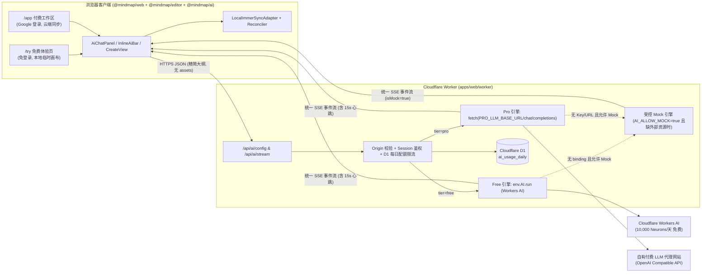

# Loomind 双层 LLM 接入方案（免费体验 Workers AI + 付费 Pro LLM 代理）

> **文档状态**：实施基线（方案 PR 合并至 `main` 后按独立任务逐项开发）
> **架构选型**：全栈保留在现有 **Cloudflare Workers + Cloudflare D1** 架构内，无需新增外部容器服务器或迁库。

---

## 1. 产品定位与双层架构总览

Loomind 将 LLM 能力清晰划分为两个产品层级，共用同一套前端 SSE 流式画图协议与文档不变量护栏：

| 维度 | 免费体验层（Free Tier） | 付费登录层（Pro Tier） |
|---|---|---|
| **入口路由** | 公开免登录体验页 **`/try`**（首页 Landing 提供醒目入口） | 已登录工作区 **`/app`**、**`/app/mindmaps/:id`**、**`/app/new`** |
| **目标用户** | 游客（免登录即可直接体验真实流式画图） | 已登录 Loomind 账号的编辑者（Owner / Editor） |
| **底层模型引擎** | **Cloudflare Workers AI**（原生 `env.AI` 绑定，免费 10,000 Neurons/天） | **平台自营付费 LLM 代理站**（标准 OpenAI 兼容 `/v1/chat/completions` 流式接口） |
| **默认模型** | 轻量高效开源模型（默认 `@cf/qwen/qwen2.5-7b-instruct` 或环境变量指定） | 高性能旗舰模型（由 `PRO_LLM_MODEL` 指定，如 GPT / Claude / Gemini） |
| **持久化与权限** | 仅浏览器本地临时画布（不写 D1，支持导出）；引导登录后保存云端 | 完整 IndexedDB + D1 乐观锁云端同步、多图管理与团队协作 |
| **防滥用配额** | 同源 `Origin` 校验 + 基于匿名哈希 IP 的 D1 每日限流（默认 10 次/天） | `__Host-loomind-session` 强鉴权 + 基于 `subject` 的 D1 每日限流（默认 100 次/天） |
| **缺失外部资源时** | 当本地无远程 Workers AI 绑定且开启 `AI_ALLOW_MOCK=true` 时，走带显式标记的 **Free Mock 流** | 当 `PRO_LLM_BASE_URL` / `PRO_LLM_API_KEY` 尚未配置且开启 `AI_ALLOW_MOCK=true` 时，走带显式标记的 **Pro Mock 流**；生产关闭 Mock 时返回明确 `503` |

---

## 2. 系统数据流与核心边界



### 关键技术边界与护栏

1. **零前端密钥暴露**：`PRO_LLM_BASE_URL` 与 `PRO_LLM_API_KEY` 仅驻留于 Cloudflare Worker 服务端环境；`/api/ai/config` 仅下发脱敏后的档位、展示名称、是否 Mock 与剩余次数。
2. **上下文最小化与隐私保护**：发送给 `/api/ai/stream` 的导图上下文剥离 `doc.assets`（图片 base64）和富文本样式，请求体 `<= 64 KiB`、`prompt <= 2,000` 字符、精简大纲 `<= 16,000` 字符。
3. **文档不变量与 1 MiB D1 体积守卫**：
   - 所有 AI 变更均经由浏览器端 `LocalImmerSyncAdapter` 落地（同一 `coalesceKey` 支持一键 `Ctrl+Z` 撤销，兼容 D1 `If-Match` 乐观锁）；
   - 双重硬限制：整图生成最多 `120` 节点、最大深度 `6`、单父节点最多 `12` 子节点、`title <= 120` 字符、`note <= 8,000` 字符；
   - 已有 `main` 基线已合入 T2（`replaceSheetRoot` 级联清理与不变量修复），确保整图重生成后写入 D1 不会触发 422。
4. **SSE 防缓冲与超时取消**：
   - 响应头统一设置 `Content-Type: text/event-stream; charset=utf-8`、`Cache-Control: no-cache, no-transform`、`X-Accel-Buffering: no`；
   - 服务端定时输出 `: ping\n\n` 心跳，前端支持 `AbortController` 一键停止生成并断开上游。
5. **Mock 透明性原则**：
   - Mock 引擎严格走完整 SSE 协议（`meta` / `status` / `map_patch` / `commands` / `message_delta` / `done`），用于在未提供真实代理站 Key 或本地离线开发时打通端到端链路与 UI；
   - 响应 `meta.isMock = true` 会在前端清晰标注「Mock 演示数据」，绝不冒充真实模型；生产环境配齐资源后设置 `AI_ALLOW_MOCK=false` 即可关闭。

---

## 3. 统一 API 与 SSE 协议契约

### 3.1 `GET /api/ai/config?tier=free|pro`

返回当前档位的可用状态与配额：
```json
{
  "tier": "free",
  "available": true,
  "isMock": false,
  "providerLabel": "Cloudflare Workers AI",
  "modelLabel": "Qwen 2.5 7B (Free)",
  "dailyLimit": 10,
  "remainingToday": 9,
  "requiresLogin": false
}
```

### 3.2 `POST /api/ai/stream`

请求体：
```json
{
  "tier": "free",
  "intent": "generate_map",
  "prompt": "2026 AI 产品增长战略",
  "locale": "zh-CN",
  "targetTopicId": "root",
  "context": {
    "sheetId": "sheet-1",
    "structure": "mindmap",
    "paletteId": "aurora",
    "activeTopicId": "root",
    "outline": { "id": "root", "title": "中心主题", "children": [] },
    "truncated": false
  }
}
```
支持 `intent`：`"generate_map" | "expand" | "tasks" | "summarize" | "cluster" | "elaborateNote" | "restyle" | "chat"`。

SSE 响应事件：
- `meta`：`{ requestId, tier, modelLabel, isMock, remainingToday }`
- `status`：`{ stage: "connecting" | "thinking" | "streaming" }`
- `map_patch`：`{ partial: DeepPartial<AiMindmapStream> }`（用于整图逐枝生长）
- `commands`：`{ ops: AiSafeCommand[] }`（用于 6 项节点操作与对话编辑）
- `message_delta`：`{ delta: string }`
- `error`：`{ code, message, retryAfterSec? }`
- `done`：`{ summary: string, appliedCount: number }`

---

## 4. 独立任务拆分（可并行/逐项交付）

| 任务编号 | 任务名称 | 核心交付范围 | 对外部资源的依赖与 Mock 策略 |
|---|---|---|---|
| **T1** | `@mindmap/ai` 协议层、SSE 客户端与护栏 | `packages/ai/src/protocol.ts`、`sse-transport.ts`、`stream-patcher.ts`、`actions.ts` 与单元测试 | **零外部资源依赖**，可直接完整开发与单测 |
| **T2** | Worker 双引擎后端、D1 限流与 Mock 兜底 | `apps/web/migrations/0005_ai_usage.sql`、`apps/web/worker/ai-providers.ts`、`ai.ts`、`auth.ts`、`wrangler.jsonc`、`env.d.ts` 与 Worker 单测 | 真实 Workers AI 远端调用与付费代理站 Key 尚未提供 → **内置真实协议解析代码 + 受控 Mock Provider 兜底**，清单记入 `docs/LLM_RESOURCES_TODO.md` |
| **T3** | `@mindmap/editor` 真实 AI 运行时接入 | `MindmapEditor.tsx`、`AiChatPanel.tsx`、`InlineAiBar.tsx`、`i18n.ts`（引擎徽章、剩余次数、Mock 标记、停止生成、升级引导、错误分级） | **零外部资源依赖**，通过 `EditorAiRuntime` 接口解耦 |
| **T4** | `@mindmap/web` 免费体验页 `/try` 与 Pro 工作区接入 | `apps/web/src/ai.ts`、`TryPlaygroundPage.tsx`、`App.tsx`（新增 `/try` 与首页入口）、`EditorWorkspace.tsx`、`CreateView.tsx`、`i18n.ts`、`app-shell.css` | **零外部资源依赖**，接入 `/api/ai/*` 即可在本地和线上端到端运行 |
| **T5** | 真实资源补全与生产切换（待人工提供资源） | 填入真实 `PRO_LLM_BASE_URL` / `PRO_LLM_API_KEY` / `PRO_LLM_MODEL`、验证 Cloudflare Workers AI 线上绑定、应用 D1 `0005` 迁移、关闭 `AI_ALLOW_MOCK` | 详见 [LLM_RESOURCES_TODO.md](./LLM_RESOURCES_TODO.md) |
